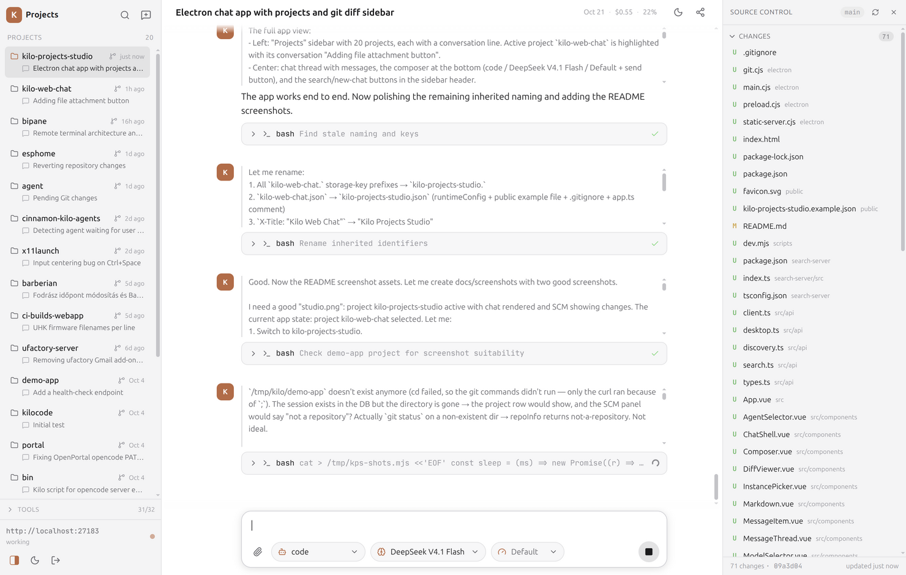
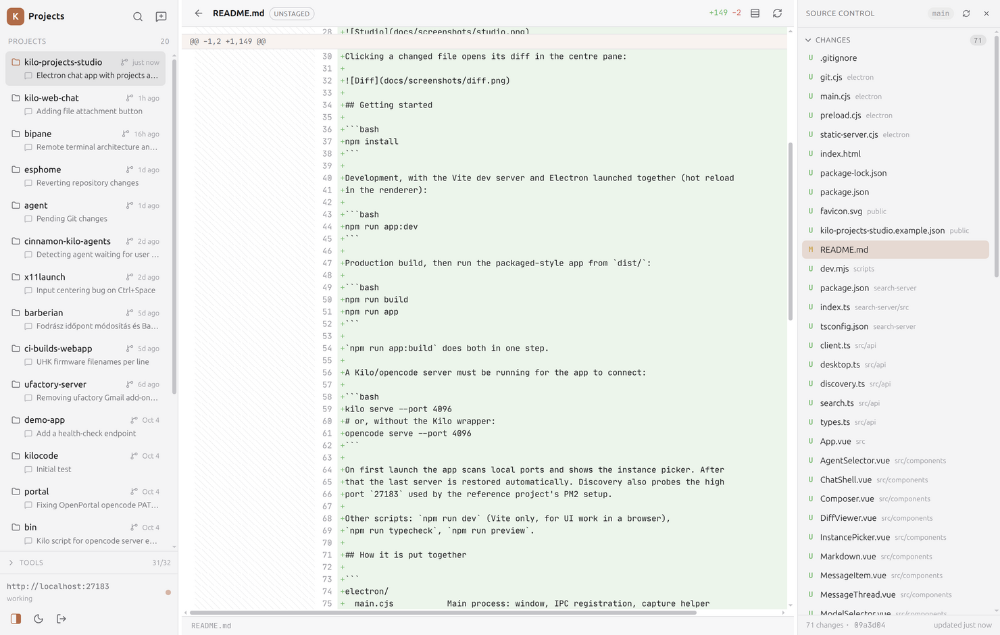

# Kilo Projects Studio

A desktop studio for **Kilo Code** / **opencode** projects, built as an **Electron**
app on top of the [kilo-web-chat](../kilo-web-chat) UI (Vue 3, Vite, TypeScript,
Reka UI).

It keeps the whole chat experience — streaming Markdown, reasoning blocks, tool
calls, permissions and questions — and reorganises it around projects instead of
conversations:

- **Projects sidebar** — every project the server knows about, each showing one
  conversation: its newest. The list is ordered by most recent activity, and the
  newest conversation of the busiest project is what opens on launch.
- **Source Control panel** — a permanent right-hand panel that lists the uncommitted
  changes of the active project's repository as a flat list of file paths,
  grouped into *Staged Changes* and *Changes*, the way VS Code's Source Control
  view does.
- **Diffs** — clicking a file in that panel opens its unified diff in the editor
  area, with split (side-by-side) and unified views, line numbers, syntax
  highlighting and `+n −m` statistics.
- **Conversation state dots** — every project row carries a dot for its newest
  conversation: red blocked, amber working, green done and not yet opened, grey
  idle.
- **Tray icon** — the same state rolled up across all projects into one badge,
  with a menu that jumps straight to the conversation that needs you.

Chat and diffs share the centre pane: opening a diff replaces the conversation
until you go back (the `←` button or `Esc`).

## Screenshots

Projects sidebar, chat, and the source-control panel for the active project:



Clicking a changed file opens its diff in the centre pane:



## Getting started

```bash
npm install
```

Development, with the Vite dev server and Electron launched together (hot reload
in the renderer):

```bash
npm run app:dev
```

Production build, then run the packaged-style app from `dist/`:

```bash
npm run build
npm run app
```

`npm run app:build` does both in one step.

A Kilo/opencode server must be running for the app to connect:

```bash
kilo serve --port 4096
# or, without the Kilo wrapper:
opencode serve --port 4096
```

On first launch the app scans local ports and shows the instance picker. After
that the last server is restored automatically. Discovery also probes the high
port `27183` used by the reference project's PM2 setup.

Other scripts: `npm run dev` (Vite only, for UI work in a browser),
`npm run typecheck`, `npm run preview`.

## Configuration

An optional runtime config is fetched from the app root as
`/kilo-projects-studio.json`. The real file is gitignored; copy the committed
template to create one:

```bash
cp public/kilo-projects-studio.example.json public/kilo-projects-studio.json
```

```json
{
  "defaultAgent": "plan"
}
```

`defaultAgent` preselects a primary agent on load, as long as the server exposes
it; a `?agent=` GET param still takes precedence.

Conversation search (`Alt`+`F`) uses the optional `kilo-search` service in
`search-server/` (a small Bun FTS5/BM25 index over message text, listening on
`127.0.0.1:27184`) when it is running, and falls back to server-side title search
when it is not.

## How it is put together

```
electron/
  main.cjs           Main process: window, IPC registration, capture helper
  preload.cjs        contextBridge surface exposed as window.kiloDesktop
  git.cjs            Git plumbing: repo detection, status, diff, stage/unstage
  static-server.cjs  Loopback static server for the production build
build/
  icon.svg           The Kilo mark, shared with the sidebar logo and favicon
  icon.png           512×512 window/taskbar icon, rasterized from icon.svg
  tray.svg           Monochrome tray glyph, matching what the app draws
  tray.png           64×64 tray base icon (panels draw a ~20px slot, so a larger
                     source is downscaled and stays crisp on HiDPI)
scripts/
  dev.mjs            Starts Vite, waits for the port, then launches Electron
src/                 Renderer (Vue 3 app inherited from kilo-web-chat)
  api/desktop.ts     Typed access to the preload bridge
  stores/projects.ts One conversation per project
  stores/git.ts      Source-control state: status polling, selection, diffs
  stores/layout.ts   Source-control panel width
  stores/desktopWindow.ts  Maximized state for the chromeless frame
  stores/sessionState.ts   Conversation state for every project and the tray
  stores/tray.ts     Rollup -> badge bitmap, tooltip and menu
  components/
    ProjectsPanel.vue     Projects sidebar (one conversation per project)
    SourceControl.vue     Right-hand source-control panel (flat, full paths)
    DiffViewer.vue        Split/unified diff view
    FileViewer.vue        Read-only file view
    FilterBar.vue         The in-place sidebar filters (Ctrl+R, Ctrl+P)
    WindowControls.vue    Minimize / maximize / close for the frameless window
    WindowResizeHandles.vue  Edge grips, since a frameless window has no border
  utils/diff.ts      Unified-diff parsing and split-view alignment
  utils/fuzzy.ts     Subsequence matching for the incremental filters
  utils/highlight.ts Syntax highlighting for the diff and file views
  utils/sessionState.ts  Pure state fold and tray rollup
  utils/trayIcon.ts  Draws the badge bitmap
```

### App icon

The application icon is the Kilo mark — the same rounded-square "K" as the logo
in the sidebar's top-left corner and as `public/favicon.svg`. `build/icon.png` is
the window, taskbar and dock icon; `build/icon.svg` is the vector source.

To regenerate the PNGs after editing the SVG (needs ImageMagick on `PATH`):

```bash
npm run icon
```

The SVG is the single source of truth, so a packaged build can derive whatever
else a platform wants from it (`.ico` for Windows, `.icns` for macOS). `build/`
is also electron-builder's default resources directory, so `icon.png` and its
derived siblings are picked up automatically if packaging is added later.

### Why the renderer is served over HTTP

Production loads the UI from `http://127.0.0.1:<port>` (a throwaway static
server started by the main process) rather than `file://`. The Kilo/opencode
server only accepts requests from loopback HTTP origins, so a `file://` page
would be blocked by CORS, and `localStorage` is unreliable there too.

### How the source control panel works

`electron/git.cjs` shells out to the user's `git`, so the panel reflects their
real repository — including their ignore rules, diff settings and rename
detection. The main process exposes four operations over IPC:

| Operation | Git command |
| --- | --- |
| Repository info | `rev-parse --is-inside-work-tree / --show-toplevel / --abbrev-ref HEAD` |
| Status | `git status --porcelain=v1 -z --untracked-files=all` |
| Diff | `git diff [--cached] --no-color -U3`, or `git diff --no-index /dev/null <file>` for untracked files |
| Stage / unstage | `git add -A -- <path>` / `git restore --staged -- <path>` |

Git has no change notification to subscribe to, so the panel re-scans the working
tree every 2.5 s while the window is visible (and immediately when the project
changes). Paths are validated against the repository root before any command
runs, and patches are capped at 2 MB.

Without git, or in a project that is not a repository, the panel degrades to an
explanatory notice instead of failing.

## The window

The app is **chromeless**: there is no OS title bar, so the header strip at the
top of the UI is the top of the window. The source-control panel is always
visible, so its header is the right-hand end of the window and carries the app's
own minimize / maximize / close buttons. Those header strips are also the
window's drag regions (`-webkit-app-region: drag`, with interactive elements
opted out), so the window is moved by its headers, and double-clicking one
maximizes it.

Two consequences of dropping the frame are handled explicitly:

- **Resizing.** Electron keeps edge resizing for frameless windows on Windows
  (`thickFrame`) but not on Linux, where the window manager has no decoration to
  grab. `WindowResizeHandles.vue` therefore draws invisible grips on all eight
  edges that resize the window through IPC. Pointer positions for those drags come
  from the main process (`screen.getCursorScreenPoint`) rather than
  `MouseEvent.screenX`, because a drag that moves the window also moves its
  coordinate space, and event deltas would feed back on themselves. While the
  window is maximized the grips are not rendered at all, since a maximized window
  cannot be resized.
- **The menu bar.** `Menu.setApplicationMenu(null)` removes it on Linux and
  Windows, which is also what stops a bare `Alt` press from pulling a menu bar
  down over the UI. macOS keeps a minimal menu, since its system menu bar carries
  the standard editing and window shortcuts (Cmd+C/V/W/Q). With no menu there is
  no reload or devtools accelerator either; for development, attach to the
  renderer with `--remote-debugging-port`.

## Conversation state and the tray

The tray is one icon summarising every project, so you can tell whether anything
needs you without the window in front. It rolls up in two steps:

1. **Conversation** — from `/session/status`, the global `/permission` and
   `/question` lists, and the global event stream.
2. **Project** — the most actionable conversation wins:
   `blocked > retry/error > working > done (unacknowledged) > idle`.
3. **Tray** — the same precedence across projects, plus the counts.

The badge is baked into the icon bitmap, since trays have no numeric-badge API:
a monochrome "K" — so it sits with the panel's own icons rather than standing out
as a coloured tile — carrying a state dot with the number of *projects* needing
attention (blocked, or done and not yet opened). The tooltip carries the
per-project breakdown. The glyph is drawn white with a hairline dark edge so it
reads on a light panel too, and the idle dot is a light grey because the muted
grey the sidebar uses disappears against a dark panel at tray size.

| Interaction | Behaviour |
| --- | --- |
| Left click | Toggle the window (where the platform delivers click events) |
| Double click | Raise the window, showing the last active conversation |
| Menu | The rollup, one entry per actionable project (and per conversation), then Open / Mute notifications / Quit |

On Linux the tray is an AppIndicator, which only really supports a menu: a left
click opens the menu rather than toggling the window, so "Open Kilo Projects
Studio" is in the menu as well. Where the tray cannot be created at all, the app
logs a warning and carries on without it.

"Done" is sticky-unread: a turn that finishes while you are not looking marks its
conversation green, and opening it clears the mark. The set is kept in
`localStorage`, so it survives a restart.

### Attention chime

When the window is not focused (or is hidden) and a conversation starts wanting
the user — blocked, or finished with the result unopened — the app plays a short
two-note chime and, for a block, raises a desktop notification. A conversation
that is merely *working* never announces itself, nothing already announced
repeats, and Mute silences both the chime and the notifications. The chime is
synthesised with the Web Audio API rather than shipped as a file, and Electron
runs with `autoplayPolicy: "no-user-gesture-required"` so it can sound without a
click first.

### How the state feed works

One global event stream (`/global/event`) carries the events of *every* project,
tagged with the directory they came from, so a single subscription keeps all the
dots and the tray current — the active project additionally has its own
per-directory stream for the conversation view. Because a stream only reports
changes, a bounded poll supplies the baseline (a session that was already busy
before the app connected) and repairs anything missed: a few projects' statuses
per tick, and the two global request lists every fourth tick.

## Keyboard shortcuts

Hold `Alt` to reveal the key badges on the controls they trigger.

| Shortcut | Action |
| --- | --- |
| `Ctrl`+`R` | Filter the projects sidebar in place |
| `Ctrl`+`P` | Filter the changed files in the source-control panel in place |
| `Alt`+`P` / `Alt`+`S` | Focus the projects list (arrow keys + `Enter`) |
| `Alt`+`N` | New conversation |
| `Alt`+`F` | Search conversations |
| `Alt`+`M` / `Alt`+`A` / `Alt`+`E` | Model / agent / effort |
| `Alt`+`C` | Focus the composer |
| `Alt`+`X` | Stop the current turn |
| `Esc` | Close the open diff, or clear a sidebar filter (ending a Ctrl+P preview) |

The two filters narrow their list as you type (subsequences work: `kwchat` finds
`kilo-web-chat`), `↑`/`↓` move the selection, `Enter` opens it and `Esc` clears
it. `Ctrl`+`R` and `Ctrl`+`P` are Chromium's reload and print by default; both are
taken over here, which is what the app's own shortcuts require.

## Syntax highlighting

Diffs and the read-only file view are highlighted with the `highlight.js` bundle
the chat already ships. Two details make it work on diffs:

- Each side of a hunk is highlighted **whole** and then split back into lines,
  with tags that straddle a line break closed and reopened. Highlighting line by
  line would colour a block comment or a multi-line string as plain code.
- Line numbers, not positions, attach the fragments to rows: a deletion exists
  only on the old side and an addition only on the new one, so the two sides
  advance independently and an uneven hunk (three deletions, one addition) still
  lines up.

The language comes from the file name (extension, plus names like `Dockerfile`).
Unknown types, binary files and anything over 3000 lines render as plain text.
Message code blocks keep the single dark palette they always had, while the
editor surfaces use a theme-aware one defined in `style.css`, since they sit on
the app background rather than a dark code surface.

## Remembered state

Theme, sidebar and panel widths, the panel's visibility, the saved server and the
unread markers all live in `localStorage`, which is keyed by origin — so the UI is
served from a **fixed** loopback port (`45999`) rather than an ephemeral one. If
that port is taken, the app falls back to an ephemeral port and says so in the
log, because settings will not persist for that run.

## Notes and limitations

- One conversation per project is deliberate: the sidebar shows each project's
  newest conversation. Older conversations remain reachable through the
  conversation search (`Alt`+`F`).
- Opening a project that has no conversation yet creates its first one.
- Renaming and deleting the shown conversation are on the project row's hover
  menu; both work against the conversation's own project, so no project switch
  is needed.
- The diff viewer renders text patches; binary changes are reported as such.
- Requires `git` on `PATH` for the source-control panel.
- If `ELECTRON_RUN_AS_NODE` is set in the environment, Electron behaves as plain
  Node; `npm run app:dev` clears it for the child process, and the main process
  exits with an explanatory message if it is still set.
- `KPS_CAPTURE=<file> npm run app` renders the window, writes a PNG of it and
  exits — handy for screenshots and CI checks. `KPS_CAPTURE_DELAY` (ms, default
  `4000`) tunes how long it waits before capturing.
